# 🎓 Online Quiz & Exam Platform

A full-featured **web-based quiz and examination system** built with **PHP**, **MySQL**, and the **MVC architectural pattern**. It supports role-based access control for four distinct user types: **Admin**, **Instructor**, **Teaching Assistant (TA)**, and **Student**.

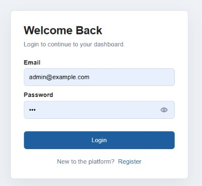

---

## 📋 Table of Contents

- [Features](#-features)
- [Tech Stack](#-tech-stack)
- [Architecture](#-architecture)
- [Project Structure](#-project-structure)
- [Database Schema](#-database-schema)
- [Getting Started](#-getting-started)
- [Default Credentials](#-default-credentials)
- [Screenshots](#-screenshots)
- [License](#-license)

---

## ✨ Features

### 🛡️ Admin
- Comprehensive dashboard with platform-wide statistics
- User management: approve/reject instructors, manage students & TAs
- Create and assign Teaching Assistants
- Course & subject management with full details view
- Quiz oversight and integrity reports
- Institutional academic reports
- Audit logs for all platform activity
- Platform settings configuration

### 👨‍🏫 Instructor
- Personal dashboard with enrolled course statistics
- Course creation and management (draft / active / archived)
- Quiz & question bank management (graded & practice types)
- Student enrollment management (open or approval-based)
- Teaching Assistant assignment per course
- Course material uploads
- Announcements per course
- Q&A thread management
- Analytics and student performance reports

### 🧑‍🎓 Student
- Dashboard with enrolled courses and upcoming quizzes
- Course browsing and enrollment requests
- Quiz-taking with configurable time limits
- Result viewing with pass/fail status
- Academic performance history

### 🗂️ Teaching Assistant (TA)
- Course-specific TA dashboard
- Q&A moderation and response
- Support for grading workflows

### 🔐 Common / Auth
- Secure registration with role selection
- Session-based authentication
- Profile management with photo upload
- Logout with session destruction

---

## 🛠️ Tech Stack

| Layer         | Technology                          |
|---------------|-------------------------------------|
| Backend       | PHP 8+                              |
| Database      | MySQL 8 / MariaDB                   |
| DB Driver     | MySQLi with prepared statements     |
| Architecture  | MVC (Model-View-Controller)         |
| Auth          | PHP Sessions + `password_hash()`    |
| Frontend      | HTML5, CSS3, JavaScript (vanilla)   |
| Local Server  | XAMPP / WAMP / Laragon              |
| API           | Custom REST-style PHP endpoints     |

---

## 🏗️ Architecture

The project follows a clean **MVC pattern** with separate entry points per role:

```
index.php       → Student entry point
admin.php       → Admin entry point
instructor.php  → Instructor entry point
ta.php          → Teaching Assistant entry point
login.php       → Authentication
register.php    → Registration
```

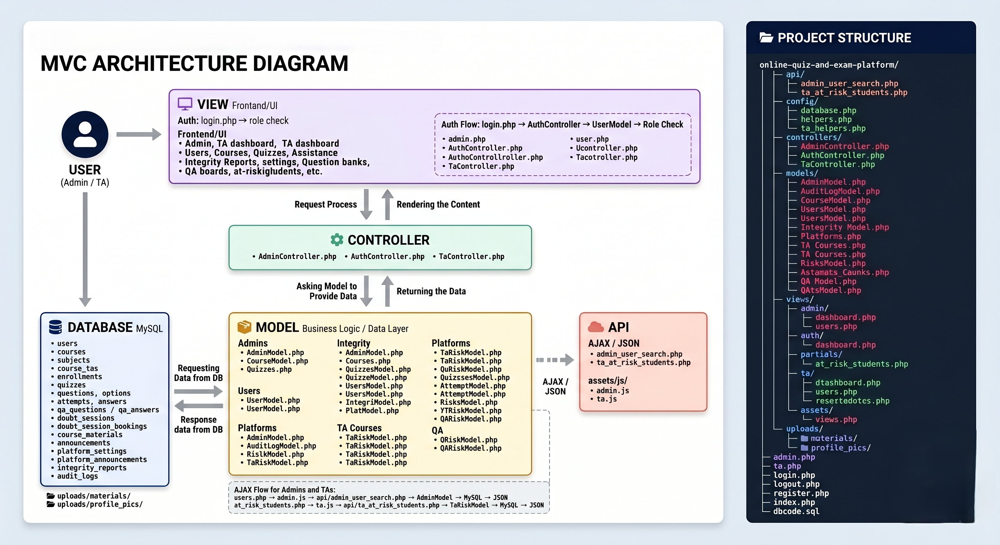

---

## 📁 Project Structure

```
online-quiz-and-exam-platform/
├── api/                        # REST-style API endpoints
├── config/                     # Database configuration
├── controllers/                # All MVC Controllers
│   ├── AdminController.php
│   ├── AuthController.php
│   ├── InstructorAnalyticsController.php
│   ├── InstructorAnnouncementController.php
│   ├── InstructorCourseController.php
│   ├── InstructorDashboardController.php
│   ├── InstructorEnrollmentController.php
│   ├── InstructorMaterialController.php
│   ├── InstructorProfileController.php
│   ├── InstructorQAController.php
│   ├── InstructorQuestionController.php
│   ├── InstructorQuizController.php
│   ├── InstructorTAController.php
│   ├── StudentController.php
│   └── TaController.php
├── models/                     # Database models (business logic)
├── views/                      # Role-separated view templates
│   ├── admin/
│   ├── auth/
│   ├── instructor/
│   ├── partials/
│   ├── student/
│   ├── ta/
│   └── assets/
├── uploads/                    # User-uploaded files (profile pics, materials)
├── screenshot/                 # Application screenshots
├── admin.php                   # Admin entry point
├── index.php                   # Student entry point
├── instructor.php              # Instructor entry point
├── ta.php                      # TA entry point
├── login.php                   # Login page
├── register.php                # Registration page
├── logout.php                  # Session logout
└── dbcode.sql                  # Full database schema + seed data
```

---

## 🗄️ Database Schema

The database `online_quiz_exam_platform` contains the following core tables:

| Table            | Description                                              |
|------------------|----------------------------------------------------------|
| `users`          | All users with roles: `student`, `instructor`, `ta`, `admin` |
| `subjects`       | Subject categories for courses                           |
| `courses`        | Courses with enrollment type and status                  |
| `course_tas`     | TA assignments per course                                |
| `enrollments`    | Student–course enrollment records                        |
| `quizzes`        | Quizzes with time limits, marks, and availability windows |
| `questions`      | Questions linked to quizzes                              |
| `options`        | MCQ answer options with correct flag                     |
| `attempts`       | Student quiz attempt records                             |

> All tables use `InnoDB` with proper foreign key constraints, indexes, and `utf8mb4` encoding.

---

## 🚀 Getting Started

### Prerequisites
- PHP 8.0+
- MySQL 8.0+ or MariaDB
- Apache (XAMPP / WAMP / Laragon recommended)

### Installation

1. **Clone the repository**
   ```bash
   git clone https://github.com/mhtamim136/online-quiz-and-exam-platform.git
   ```

2. **Move to your server's web root**
   ```bash
   # For XAMPP on Windows:
   # Copy the folder to: C:/xampp/htdocs/
   ```

3. **Import the database**
   - Open **phpMyAdmin** → go to the **SQL** tab
   - Paste the entire content of `dbcode.sql` and execute
   - This will create the `online_quiz_exam_platform` database with all tables and seed data

4. **Configure database connection**
   - Open `config/` and update your DB host, username, and password if needed

5. **Start Apache & MySQL** in XAMPP/WAMP

6. **Visit the application**
   ```
   http://localhost/online-quiz-and-exam-platform/login.php
   ```

---

## 🔑 Default Credentials

> ⚠️ These are for **local development only**. Change all passwords before any deployment.

| Role        | Email / Username              | Password       |
|-------------|-------------------------------|----------------|
| Admin       | `admin@example.com` / `tamim` | `136`          |
| Instructor  | `farhan.instructor@example.com` | `instructor123` |
| Instructor  | `nadia.instructor@example.com`  | `instructor123` |
| Student     | `ayesha.student@example.com`  | `student123`   |
| Student     | `rafi.student@example.com`    | `student123`   |
| TA          | `sami.ta@example.com`         | `ta123`        |
| TA          | `jarin.ta@example.com`        | `ta123`        |
| Pending Instructor | `pending.instructor1@example.com` | `pending123` |

---

## 📸 Screenshots

### Login & Registration
| Login | Registration |
|-------|-------------|
|  | 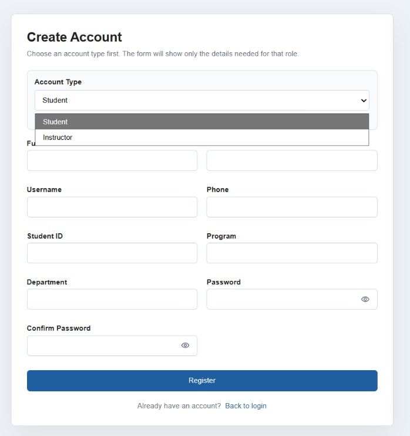 |

### Admin Panel
| Dashboard | User Control | Instructor Approval |
|-----------|-------------|---------------------|
| 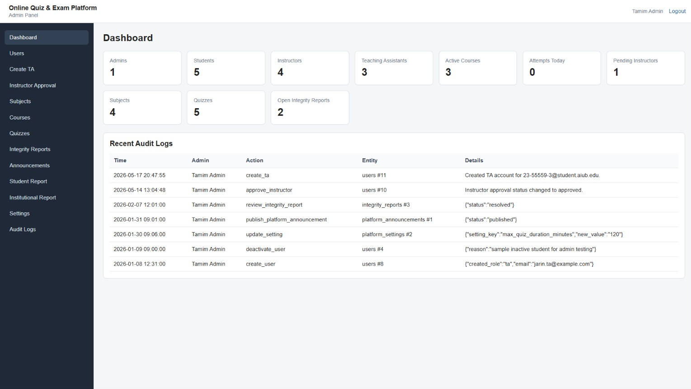 | 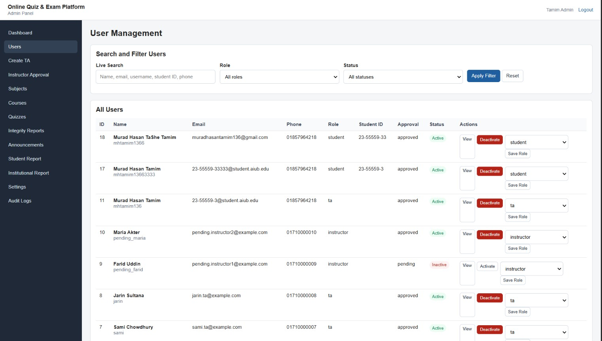 | 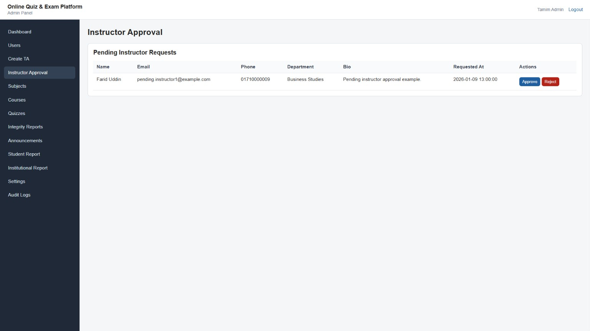 |

| Courses | Quiz Details | Audit Logs |
|---------|-------------|------------|
| 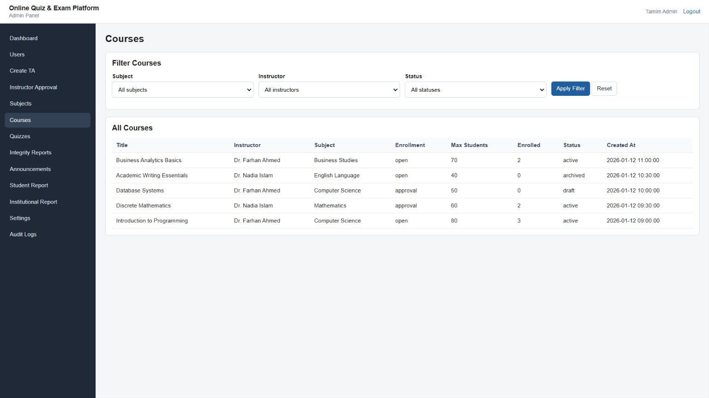 | 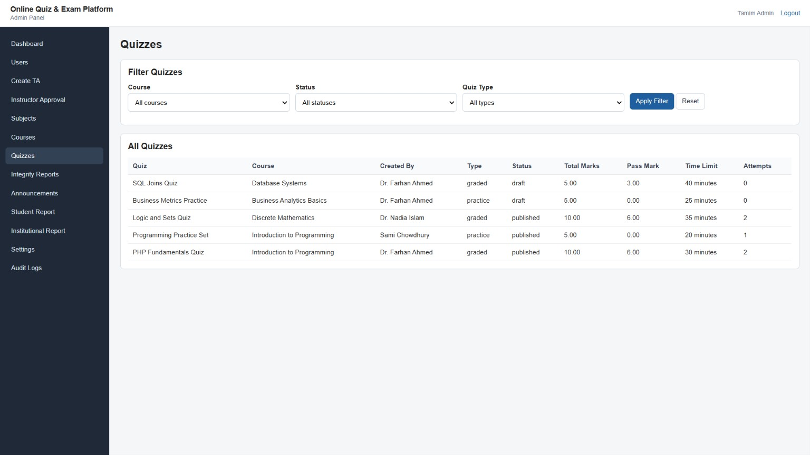 | 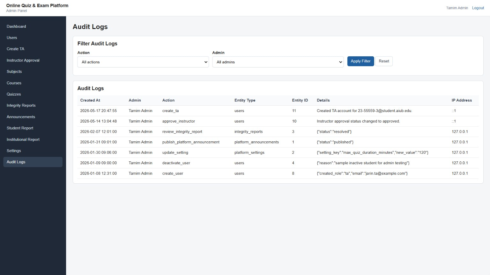 |

| Institutional Report | Integrity Report | Platform Settings |
|----------------------|-----------------|-------------------|
| 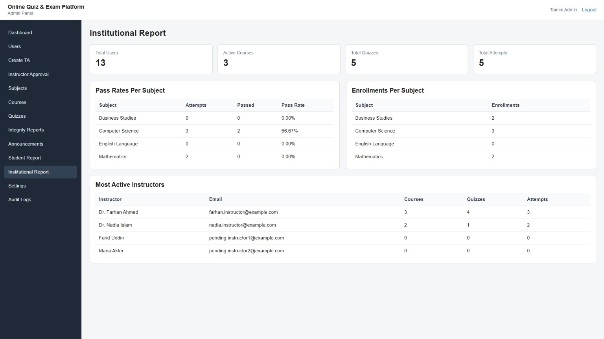 | 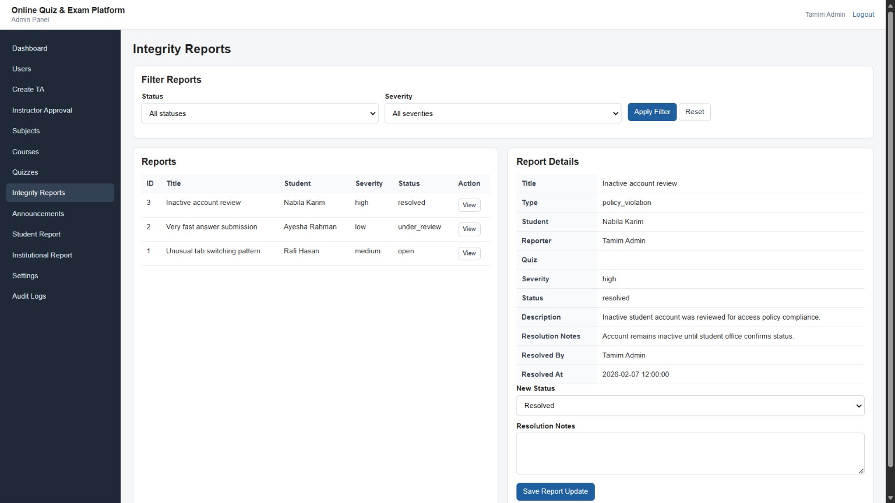 | 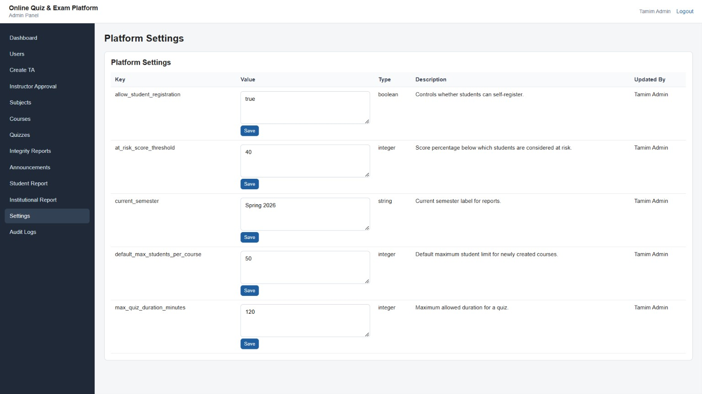 |

### Instructor Panel
| Dashboard |
|-----------|
| 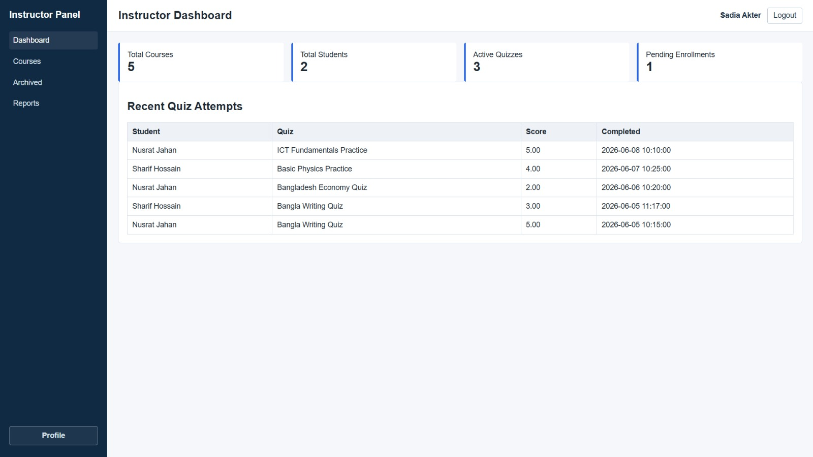 |

### Student Panel
| Dashboard |
|-----------|
| 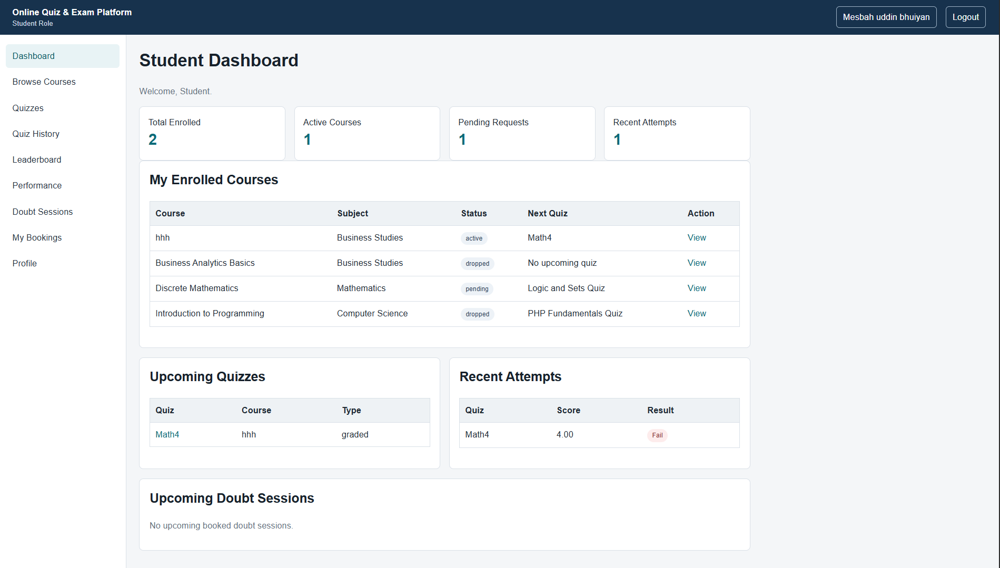 |

---

## 📄 License

This project is open-source and available under the [MIT License](LICENSE).

---

<p align="center">
  Built with ❤️ using PHP, MySQL & MVC Pattern
</p>
